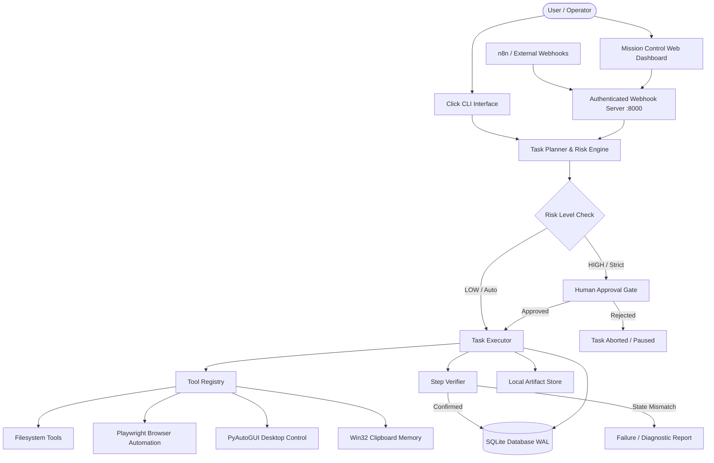

# Personal AI Automation System — End-to-End Workflow & Implementation Summary

**Repository**: Personal AI Automation System for Windows  
**Status**: All 9 Phases Complete | 96 Automated Tests Passing (100%)  
**Runtime**: Python 3.11+, SQLite 3 (WAL mode), Playwright, PyAutoGUI, Windows Win32 API  

---

## 1. Executive Summary & Architecture

The **Personal AI Automation System** is a modular, local-first automation runtime designed specifically for Windows. It delivers end-to-end task decomposition, deterministic planning with AI provider fallback, browser and desktop control, persistent SQLite audit trails, clipboard memory with privacy controls, human-in-the-loop approvals, n8n webhook orchestration, a glassmorphic Mission Control web dashboard, and disaster recovery.



---

## 2. Complete Phase-by-Phase Implementation Workflow

### Phase 1: Environment, Foundation & Storage Layer
- **Pydantic Settings**: Centralized configuration in `src/personal_ai/config.py` loading `.env` variables (database paths, logging levels, approval modes, timeout settings).
- **Structured Logging**: `src/personal_ai/logging/setup.py` providing dual-stream logging: colored console output and rotating file logs (`logs/personal_ai.log`).
- **SQLite Database with WAL Mode**: `src/personal_ai/storage/database.py` enforces Write-Ahead Logging (`PRAGMA journal_mode = WAL`) and foreign keys (`PRAGMA foreign_keys = ON`).
- **Idempotent Migrations**: Automated schema version table tracking migrations for `tasks`, `task_steps`, `approvals`, `artifacts`, and `clipboard_entries`.
- **Repositories**: Clean data access layer (`TaskRepository`, `StepRepository`, `ApprovalRepository`, `ClipboardRepository`).
- **Artifact Management**: `ArtifactManager` saves text, JSON, and binary files with MIME type detection and hash tracking in `artifacts/`.
- **CLI Foundation**: Click commands `init-db` and `status`.

---

### Phase 2: Working Task Runtime & Execution Engine
- **Task Modeling**: Strict Pydantic schemas in `src/personal_ai/agent/task_models.py` (`PlanStep`, `ExecutionPlan`, `StepResult`, `TaskReport`, `TaskStatus`, `StepStatus`, `RiskLevel`).
- **Tool Registry**: Central `ToolRegistry` validating tool input arguments via Pydantic schemas and preventing invalid execution.
- **Filesystem Tools**: Secure file operations in `src/personal_ai/tools/filesystem.py`:
  - `read_file`: Safe text reading with byte limits.
  - `write_file`: Controlled writing with overwrite flags.
  - `list_directory`: Folder listing with file metadata.
  - `delete_file`: High-risk deletion requiring approval.
- **Deterministic Task Planner**: `TaskPlanner` uses rule-based parsing with intent extraction and handles clarification requests for ambiguous prompts.
- **Independent Step Verification**: `StepVerifier` checks target states (file existence, content matches, directory contents) rather than blindly assuming tool success.
- **Permission & Risk Engine**: Three-tier risk classification (`LOW`, `MEDIUM`, `HIGH`) with configurable policies (`safe`, `strict`, `auto`).
- **Sequential Executor**: `TaskExecutor` audits every step in SQLite, enforces human approval gates, verifies results, and supports cancellation.

---

### Phase 3: Browser Automation
- **Playwright Chromium Integration**: Headless and headed automation in `src/personal_ai/tools/browser.py` managed via `BrowserSessionManager`.
- **Browser Capabilities**:
  - `browser_open_url`: Navigates to target web pages with timeout guards.
  - `browser_extract_content`: Extracts page title, headings, text content, and links.
  - `browser_screenshot`: Captures full-page screenshots directly to `artifacts/`.
  - `browser_click`: Locates elements using semantic selectors (`text=...`, CSS) and clicks.
  - `browser_fill`: Types text into form input fields.
- **Verification**: `StepVerifier` verifies URL loading, expected DOM text, and element presence.

---

### Phase 4: AI Model Providers
- **Provider-Agnostic Interface**: `BaseModelProvider` in `src/personal_ai/models/` defining text generation and structured plan creation.
- **Local Ollama Adapter**: Connects to `http://localhost:11434` for local, offline execution with model checks and health monitoring.
- **Cloud Provider Adapter**: OpenAI/Anthropic compatible REST client with token authentication, custom endpoints, and rate-limit handling.
- **Mock Provider**: Fast, zero-network adapter for deterministic testing.
- **Automatic Fallback Planning**: If an LLM provider is offline, unreachable, or returns invalid JSON, `TaskPlanner` automatically falls back to deterministic rule-based planning.
- **CLI Commands**: `personal-ai model status` and `personal-ai model test`.

---

### Phase 5: Clipboard Memory
- **Native Windows Win32 API**: Uses `ctypes.windll.user32` (`OpenClipboard`, `GetClipboardData`, `GlobalAlloc`) without external process spawns.
- **Multi-Format Classification**: Classifies clipboard entries into `text`, `url`, `code`, and `prompt`.
- **SHA-256 Deduplication**: Hashes content to avoid redundant records across poll cycles.
- **Privacy Controls**:
  - Excludes password manager windows (1Password, Bitwarden, KeePass, Windows Security Credentials).
  - Redacts high-entropy API tokens, bearer keys, and credit card numbers.
  - Zero cloud uploads by default.
- **Clipboard Management**: Background polling monitor (`ClipboardMonitor`), SQLite search, and CLI commands (`list`, `search`, `copy`, `capture`, `clear`).

---

### Phase 6: Windows Desktop Control
- **Interactive Session Attachment**: Resolves Windows GDI Session 0 isolation by calling `user32.OpenInputDesktop` and `user32.SetThreadDesktop` to ensure background workers access active user displays without `OSError: screen grab failed`.
- **Desktop Tools**:
  - `get_screen_resolution` & `validate_screen_coordinates`: Multi-monitor display geometry inspection.
  - `list_open_windows` & `focus_window_by_title`: Window listing and `SetForegroundWindow` focus.
  - `capture_desktop_screenshot`: Full desktop screen capture saved to `artifacts/`.
  - `desktop_mouse_click` & `desktop_mouse_move`: Boundary-checked mouse clicks.
  - `desktop_type_text` & `desktop_press_hotkey`: Keyboard simulation.
- **CLI Commands**: `desktop screen`, `windows`, `focus`, `screenshot`, `click`, `type`, `hotkey`.

---

### Phase 7: Workflow Automation (n8n Integration)
- **Multi-Threaded HTTP Webhook Server**: Running at `127.0.0.1:8000` (`src/personal_ai/workflows/server.py`):
  - `POST /webhook/task`: Dispatches tasks with optional auto-approval.
  - `GET /webhook/task/<id>`: Fetches task status, execution steps, and artifact links.
  - `POST /webhook/notify`: External notification receiver.
  - `GET /health`: Server health check.
- **Security & Socket Draining**:
  - Mandatory `X-API-Key` authentication header.
  - Windows TCP socket buffer draining prevents client-side `[WinError 10053]` connection resets.
- **n8n Client & Docker**:
  - `N8nWebhookClient` with exponential backoff and retry callbacks.
  - Docker Compose configuration (`workflows/n8n/docker-compose.yml`) bound strictly to `127.0.0.1:5678`.
  - Complete ready-to-import n8n workflow template (`workflows/n8n/example_workflow.json`).
  - Integration guide: `docs/n8n_integration.md`.

---

### Phase 8: Web Dashboard & Mission Control
- **Glassmorphic Single-Page Application**:
  - `src/personal_ai/dashboard/static/index.html`: Semantic HTML layout.
  - `src/personal_ai/dashboard/static/style.css`: Custom dark-mode glassmorphic theme with CSS custom properties, cards, and animations (zero external framework bloat).
  - `src/personal_ai/dashboard/static/app.js`: Reactive JavaScript client with tab navigation and auto-refresh intervals.
- **Dashboard Features**:
  1. **Task Dispatcher & History**: Real-time task submission, step progress badges (`COMPLETED`, `RUNNING`, `FAILED`), and output logs.
  2. **Pending Approvals**: Modal to inspect and approve/reject pending high-risk steps.
  3. **Artifact Explorer**: Browse generated artifacts with direct file download links (`/api/artifacts/file/<id>`).
  4. **Clipboard Memory**: Real-time clipboard history, search bar, and one-click copy back to clipboard.
  5. **Desktop & Windows**: Resolution metrics, active desktop screenshot preview, and visible window list with focus buttons.
  6. **Streaming System Logs**: Real-time inspection of `logs/personal_ai.log`.
- **CLI Command**: `personal-ai dashboard --port 8000`.

---

### Phase 9: Hardening, Security, Disaster Recovery & Deliverables
- **Atomic Online SQLite Backup & Restore**:
  - `src/personal_ai/storage/backup.py` uses `sqlite3.Connection.backup` to create clean, WAL-safe backups without shutting down the runtime.
  - Pre-restore safety copy guarantees no unrecoverable overwrites.
- **Artifact Filesystem Verification**:
  - `verify_artifacts` cross-references all SQLite artifact records against disk files to detect missing or 0-byte corrupted files.
- **Conservative Interrupted Task Recovery**:
  - `src/personal_ai/agent/recovery.py` identifies tasks interrupted by power loss or reboot.
  - **Irreversible Step Protection**: Irreversible tools (`delete_file`, `write_file`, mouse clicks) are **never automatically repeated**; the recovery manager marks them for human inspection.
- **Path Containment & Traversal Defense**:
  - `src/personal_ai/agent/security.py` blocks write and delete access to Windows system roots (`C:\Windows`, `C:\Program Files`, root drives `C:\`).
- **Indirect Prompt Injection Defense**:
  - `scan_untrusted_content` detects system override prompts inside external web pages or files.
- **Global Emergency Stop**:
  - `EmergencyStopManager` (`personal-ai stop`) halts running task loops immediately before any subsequent step executes.
- **Required Deliverables Produced**:
  - `docs/troubleshooting.md`: Common Windows runtime, Playwright, GDI, and port fixes.
  - `docs/security_and_privacy.md`: Risk tiering, containment, privacy, and injection defense.
  - `docs/feature_status_report.md`: Capability matrix showing implemented and platform-constrained features.

---

## 3. Automated Test Suite Metrics

Every phase was implemented using strict Test-Driven Development (TDD). The test suite consists of **96 unit, integration, and browser tests**:

```powershell
.\.venv\Scripts\pytest.exe -v
```

| Test Module | Coverage Area | Tests | Status |
|---|---|:---:|:---:|
| `tests/browser/test_playwright_tools.py` | Browser navigation, DOM extraction, screenshot, and end-to-end task | 3 | **PASSED** |
| `tests/integration/test_task_execution.py` | End-to-end multi-step write and read task execution | 1 | **PASSED** |
| `tests/unit/test_artifacts.py` | Artifact storage, task linkage, and JSON serialization | 3 | **PASSED** |
| `tests/unit/test_backup_restore.py` | Online SQLite backup, restore, validation, and artifact verification | 5 | **PASSED** |
| `tests/unit/test_cli.py` | CLI commands (`version`, `init-db`, `status`, `task list`, `task show`) | 3 | **PASSED** |
| `tests/unit/test_clipboard.py` | Content classification, secret redaction, Win32 API, monitor, planner | 6 | **PASSED** |
| `tests/unit/test_config.py` | Settings defaults and directory auto-creation | 2 | **PASSED** |
| `tests/unit/test_dashboard.py` | Dashboard HTML/CSS/JS delivery, REST APIs (tasks, approvals, clipboard, desktop) | 10 | **PASSED** |
| `tests/unit/test_database.py` | Schema creation, WAL configuration, and idempotent migrations | 2 | **PASSED** |
| `tests/unit/test_desktop.py` | Screen geometry, coordinate validation, window focus, clicks, hotkeys | 10 | **PASSED** |
| `tests/unit/test_executor.py` | Sequential execution, human approval pause, and task cancellation | 3 | **PASSED** |
| `tests/unit/test_models.py` | Mock provider, Ollama offline handling, Cloud provider, fallback planning | 10 | **PASSED** |
| `tests/unit/test_permissions.py` | Risk tiering in `safe`, `strict`, and `auto` permission modes | 3 | **PASSED** |
| `tests/unit/test_planner.py` | Clarification queries, read file planning, and high-risk deletion planning | 3 | **PASSED** |
| `tests/unit/test_recovery.py` | Stuck task detection, irreversible action protection, mark failed, recovery report | 5 | **PASSED** |
| `tests/unit/test_repositories.py` | Task, Step, Approval, and Clipboard SQLite repositories | 4 | **PASSED** |
| `tests/unit/test_security_hardening.py` | Path containment, injection scanner, secret redaction, emergency stop | 8 | **PASSED** |
| `tests/unit/test_task_models.py` | Pydantic task models, plan serialization, and step results | 3 | **PASSED** |
| `tests/unit/test_tool_registry.py` | Dynamic registration, argument schemas, filesystem tool operations | 2 | **PASSED** |
| `tests/unit/test_verification.py` | Independent step verification for files and content | 3 | **PASSED** |
| `tests/unit/test_webhook_server.py` | Health endpoint, API key authentication, payload checks, n8n client | 7 | **PASSED** |
| **TOTAL** | **Full System Test Suite** | **96** | **100% PASSED** |

---

## 4. Git Commit History

The repository has been structured into clean, atomic commits corresponding to each phase:

```text
0fb79e9 feat: complete Phase 9 Hardening, Backup, Recovery, and Deliverables
0069ac6 feat: complete Phase 8 Web Dashboard and Mission Control
921593f feat: complete Phase 7 n8n workflow integration and authenticated webhook server
5e16b5c feat: complete Phase 6 Windows desktop control and screen verification
fb914e2 feat: complete Phase 5 Windows clipboard memory and tools
33b97d7 feat: complete Phase 4 AI model providers (Ollama, Cloud, Mock) and structured planning
d4039e8 feat: complete Phase 3 Playwright browser automation and verification
45c119a chore: remove accidental file C
28beeaa feat: complete Phase 2 task runtime, planning, tool registry, and verification
bf11f45 feat: complete Phase 1 foundation, storage, and CLI
```

---

## 5. Quick-Reference Command Cheat Sheet

```powershell
# 1. Inspect System & Database Health
.\.venv\Scripts\python.exe -m personal_ai.main status

# 2. Launch Mission Control Web Dashboard
.\.venv\Scripts\python.exe -m personal_ai.main dashboard

# 3. Execute a Natural Language Task
.\.venv\Scripts\python.exe -m personal_ai.main run "read file 'README.md'"

# 4. Desktop Inspection & Control
.\.venv\Scripts\python.exe -m personal_ai.main desktop screen
.\.venv\Scripts\python.exe -m personal_ai.main desktop windows
.\.venv\Scripts\python.exe -m personal_ai.main desktop screenshot

# 5. Clipboard Memory
.\.venv\Scripts\python.exe -m personal_ai.main clipboard list
.\.venv\Scripts\python.exe -m personal_ai.main clipboard search "query"

# 6. Database Backup & Disaster Recovery
.\.venv\Scripts\python.exe -m personal_ai.main db backup
.\.venv\Scripts\python.exe -m personal_ai.main db backups
.\.venv\Scripts\python.exe -m personal_ai.main db verify-artifacts
.\.venv\Scripts\python.exe -m personal_ai.main task recover

# 7. Global Emergency Stop
.\.venv\Scripts\python.exe -m personal_ai.main stop
.\.venv\Scripts\python.exe -m personal_ai.main reset-stop
```
