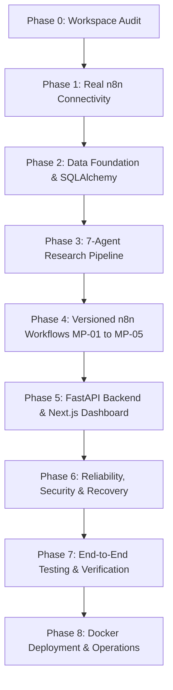

# MarketPulse AI — Prioritized Implementation Plan

**System**: MarketPulse AI — Indian Financial-Market Intelligence Platform  
**Target Architecture**: FastAPI Backend + Next.js Frontend + SQLAlchemy (PostgreSQL / SQLite) + n8n Automation Engine  
**Execution Strategy**: Test-Driven, Incremental Phases preserving 100% of working baseline code.

---

## 1. Phase Roadmap Overview

---

## 2. Phase Breakdown & Acceptance Criteria

### Phase 0: Workspace Audit (COMPLETE)
- **Objective**: Establish baseline test pass rate, map all installed runtimes, verify Docker/n8n daemon status, and document missing credentials safely.
- **Deliverables**:
  - `docs/ENVIRONMENT_AUDIT.md` (Delivered)
  - `docs/IMPLEMENTATION_PLAN.md` (This document)
- **Baseline**: 96 tests passing.

---

### Phase 1: Real n8n Connectivity
- **Objective**: Build a production-quality, authenticated n8n REST API and webhook client that interfaces with the user's real n8n instance.
- **Components to Implement**:
  - `N8nClient` in `src/marketpulse/n8n/client.py`:
    - Reads `N8N_BASE_URL` and `N8N_API_KEY` securely from configuration.
    - REST API operations using `X-N8N-API-KEY` header:
      - `test_connection()`: Hits `/api/v1/healthz` or `/api/v1/workflows` to verify credentials.
      - `list_workflows()`: Retrieves registered workflows.
      - `get_workflow(workflow_id)`: Fetches workflow schema and checks `active` state.
      - `get_execution(execution_id)`: Queries execution status and returned data.
      - `trigger_webhook(...)`: Triggers event-driven execution with correlation ID.
    - Connection state classification: `CONNECTED`, `DISCONNECTED`, `UNAUTHORIZED`, `MISCONFIGURED`.
    - Bounded exponential retries for transient HTTP errors; fail fast on `401 Unauthorized`.
    - Redaction of sensitive tokens in error messages and logs.
  - Harmless verification workflow `MP-00-connectivity-test.json`:
    - Accepts `{ "correlation_id": "...", "timestamp": "..." }` and returns `{ "status": "success", "echo": ... }`.
- **Quality Gate**:
  - Unit tests with mock responses for error classifications (401, 500, timeouts).
  - Explicit integration test targeting real n8n instance (skipped gracefully if instance is offline with clear manual startup steps).

---

### Phase 2: Data Foundation & Persistence
- **Objective**: Define enterprise data schemas for Indian equity intelligence with provenance, deduplication, and multi-dialect database support (PostgreSQL in production, SQLite in local tests).
- **Components to Implement**:
  - `src/marketpulse/storage/`:
    - SQLAlchemy models:
      - `Company`: NSE/BSE symbols, ISIN, sector, industry, market cap tier.
      - `Sector`: Nifty sector taxonomy.
      - `SourceRegistry`: Approved source metadata, access type, reliability score, licensing notes.
      - `Article`: URL, title, normalized text, publish timestamp (UTC), retrieval timestamp, content hash (SHA-256 for deduplication).
      - `MarketObservation`: Price, volume, delivery percentage, corporate actions (untrusted until verified).
      - `ResearchJob`: Job status, correlation ID, target companies, parameters.
      - `ResearchReport`: Executive summary, bull/bear/base scenarios, counterarguments, limitations.
      - `EvidenceItem`: Fact claims, source URL citation, publication timestamp, confidence score.
      - `Watchlist` & `AlertRule`: Tracked companies, trigger conditions, deduplication keys.
      - `AuditEvent`: Provenance tracking for every data collection and user approval.
  - Database engine supporting PostgreSQL and SQLite fallback with idempotent initialization.
- **Quality Gate**:
  - Model constraint tests (unique constraints, foreign keys, timestamps).
  - Deduplication tests on identical article hashes.

---

### Phase 3: Modular Research Pipeline
- **Objective**: Construct the 7 specialized financial intelligence agents using explicit, bounded Python orchestration and source-provenance verification.
- **Agents to Implement in `src/marketpulse/research/`**:
  1. `NewsIntelligenceAgent`: Extracts permitted articles, filters noise, scores materiality.
  2. `CompanyMappingAgent`: Maps freeform news text and announcements to canonical NSE/BSE tickers and Nifty sectors.
  3. `MarketContextAgent`: Gathers historical context, price trends, and peer sector benchmarks without fabricating prices.
  4. `EvidenceExtractionAgent`: Extracts verified facts, figures, and direct quotes, mapping them to provenance source URLs.
  5. `ResearchSynthesisAgent`: Constructs balanced investment thesis with Bull, Base, and Bear scenarios.
  6. `CounterargumentReviewAgent`: Red-teams the synthesis, identifies risks, regulatory flags, and data freshness limitations.
  7. `ReportGenerationAgent`: Assembles final structured report adhering to the strict Pydantic output schema.
- **Safety**:
  - Indirect prompt injection defense: source text is quarantined as untrusted data.
  - Zero hallucination policy: unverified metrics are rejected or flagged as unconfirmed.

---

### Phase 4: Versioned n8n Workflows
- **Objective**: Build and document the 5 production workflows in `workflows/n8n/`.
- **Workflows**:
  - `MP-01`: **Daily Market Brief** (Scheduled pre-market analysis of permitted corporate disclosures and macro indicators).
  - `MP-02`: **News Intelligence** (Event-driven parsing of regulatory filings and news feeds).
  - `MP-03`: **On-Demand Research** (Webhook-triggered deep dive research job on a user-specified company).
  - `MP-04`: **Watchlist Alerts** (Deduplicated alert dispatch to Webhook/Dashboard based on material triggers).
  - `MP-05`: **Health & Failure Recovery** (Periodic ping, failure notification, and stuck-job recovery trigger).
- **Artifacts**:
  - Valid n8n JSON exports with explicit input/output schemas, correlation IDs, and retry policies.
  - Step-by-step activation and credential linking guide.

---

### Phase 5: FastAPI Backend & Next.js Dashboard
- **Objective**: Expose authenticated REST endpoints and build a high-performance Next.js dashboard.
- **Backend (FastAPI)** in `src/marketpulse/api/`:
  - `GET /api/v1/health`: Service health and n8n connectivity status.
  - `GET /api/v1/n8n/status`: Real-time n8n connection and workflow activation states.
  - `GET /api/v1/companies`: Company and sector search.
  - `POST /api/v1/research/jobs`: Submit research jobs with idempotency keys.
  - `GET /api/v1/research/jobs/{id}`: Polling/streaming job progress.
  - `GET /api/v1/research/reports/{id}`: Retrieve structured report with evidence references.
  - `GET /api/v1/watchlists` & `POST /api/v1/watchlists`: Watchlist management.
  - `GET /api/v1/approvals` & `POST /api/v1/approvals/{id}/resolve`: High-risk action approvals.
- **Frontend (Next.js + TypeScript + Tailwind)** in `frontend/`:
  - Views: Market Overview, News Intelligence, Watchlists, Research Reports, Job Queue, Workflow Health, Approvals.
  - Visual indicators for data freshness and disconnected integrations.

---

### Phase 6: Reliability, Security & Recovery
- **Objective**: Harden the platform against common vulnerabilities and operational failures.
- **Mechanisms**:
  - Server-side API key authentication and CORS confinement.
  - Input validation with Pydantic; SSRF protection on user-supplied URLs.
  - Rate limiting on public and webhook endpoints.
  - Secret masking in all log output.
  - Idempotent job execution with correlation IDs.
  - Graceful degradation if n8n or external feeds are down.
  - Database transaction rollbacks on failure.

---

### Phase 7: Testing & Quality Gates
- **Objective**: Validate complete system integrity with automated tests.
- **Test Matrix**:
  - Unit tests for all agents, models, and utility functions.
  - API validation and authentication tests.
  - n8n contract tests (both mock and live test capability).
  - Prompt injection resistance tests.
  - Database migration tests.
  - Playwright browser end-to-end tests for the dashboard.

---

### Phase 8: Deployment & Operations
- **Objective**: Provide reproducible, production-ready deployment configurations.
- **Deliverables**:
  - Multi-container `docker-compose.yml` (PostgreSQL, n8n, FastAPI Backend, Next.js Frontend).
  - Production `Dockerfile` for backend and frontend.
  - Backup and restore runbooks.
  - Operations and troubleshooting manual.

---

## 3. Next Immediate Step: Phase 1 (Real n8n Connectivity)
1. Add `fastapi` and `sqlalchemy` to `pyproject.toml` so dependencies are aligned.
2. Implement `N8nClient` with full REST API support (`X-N8N-API-KEY`), connection testing, workflow status, and execution tracking.
3. Create harmless verification workflow `MP-00-connectivity-test.json`.
4. Add unit and integration tests verifying connection states, error handling, and timeout behavior.
