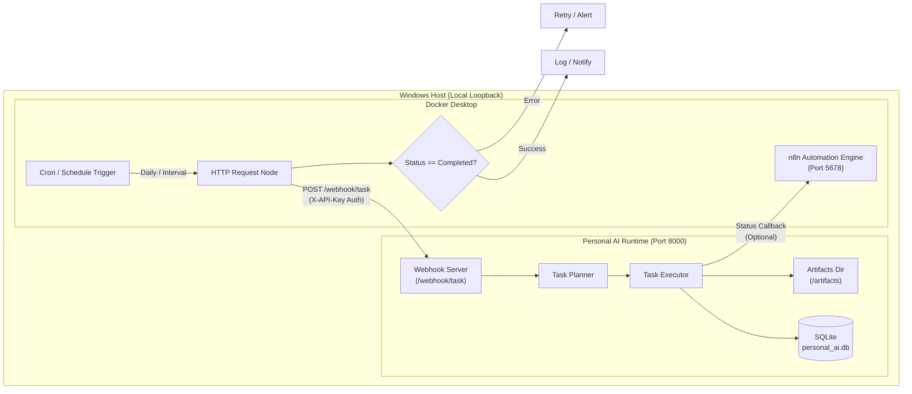

# n8n Workflow Automation Integration Guide

This guide describes how to integrate the Personal AI Automation System with a local [n8n](https://n8n.io/) workflow automation instance running on Windows.

---

## 1. Architecture Overview

Personal AI exposes a lightweight, authenticated HTTP server on `127.0.0.1:8000` designed specifically for communication with local orchestrators like n8n.



---

## 2. Docker Compose Setup

A hardened, local-only `docker-compose.yml` is provided in [`workflows/n8n/docker-compose.yml`](../workflows/n8n/docker-compose.yml).

### Key Security & Configuration Decisions
1. **Local-Only Binding**: Ports are mapped strictly to `127.0.0.1:5678:5678`. It is **never** bound to `0.0.0.0` or exposed publicly to the local network or internet.
2. **Host Bridge Networking**: `extra_hosts: ["host.docker.internal:host-gateway"]` allows the containerized n8n engine to communicate with the Personal AI runtime running on your Windows host via `http://host.docker.internal:8000`.
3. **Data Persistence**: Uses a Docker named volume `personal_ai_n8n_data` mounted at `/home/node/.n8n` to store all workflows and credentials.
4. **Encryption Key**: Encrypted secrets at rest using `N8N_ENCRYPTION_KEY`.

### Starting n8n
From the project root:
```powershell
docker compose -f workflows/n8n/docker-compose.yml up -d
```

Check container status and logs:
```powershell
docker compose -f workflows/n8n/docker-compose.yml ps
docker compose -f workflows/n8n/docker-compose.yml logs -f
```

Open your browser to `http://127.0.0.1:5678` to complete initial local admin account setup.

---

## 3. Starting the Personal AI Webhook Server

In your terminal or as a Windows background task, launch the webhook server:

```powershell
.\.venv\Scripts\python.exe -m personal_ai.main server start
```
By default, the server binds to `127.0.0.1:8000`.

### Verifying Server Health
```powershell
curl -i http://127.0.0.1:8000/health
```
Response:
```json
{
  "status": "healthy",
  "runtime": "Personal AI Automation System",
  "version": "0.1.0"
}
```

---

## 4. API Endpoints & Authentication

All endpoints under `/webhook/*` require authentication using your configured `WEBHOOK_API_KEY` (configured in `.env`).

Authentication can be passed via:
- Header: `X-API-Key: <your_secret_key>`
- Header: `Authorization: Bearer <your_secret_key>`

Unauthenticated requests receive HTTP `401 Unauthorized`.

### 1. Trigger Automation Task
- **Endpoint**: `POST /webhook/task`
- **Headers**:
  - `X-API-Key: <your_secret_key>`
  - `Content-Type: application/json`
- **Request Body**:
```json
{
  "prompt": "take desktop screenshot",
  "auto_approve": true,
  "priority": "normal",
  "callback_url": "http://host.docker.internal:5678/webhook/personal-ai-callback",
  "metadata": {
    "workflow_run_id": "wf-10293"
  }
}
```

- **Response Body** (HTTP `200 OK`):
```json
{
  "task_id": "25a10a10-e857-4695-aa7f-ccdd39e1090e",
  "status": "completed",
  "summary": "All 1 steps executed and verified successfully.",
  "plan": { ... },
  "report": {
    "task_id": "25a10a10-e857-4695-aa7f-ccdd39e1090e",
    "status": "completed",
    "total_steps": 1,
    "completed_steps": 1,
    "failed_steps": 0,
    "artifacts": [
      {
        "id": "664ddeec-1551-4087-9b93-2ac49854c08c",
        "file_path": "artifacts/25a10a10-.../desktop_25a10a10.png",
        "size_bytes": 347057
      }
    ]
  }
}
```

### 2. Query Task Status
- **Endpoint**: `GET /webhook/task/{task_id}`
- **Headers**: `X-API-Key: <your_secret_key>`
- **Response**: Full task record, steps lifecycle, and artifacts registered in SQLite.

### 3. Send Notification / Event
- **Endpoint**: `POST /webhook/notify`
- **Request Body**:
```json
{
  "event": "report.emailed",
  "source": "n8n",
  "data": {
    "recipient": "user@example.com",
    "timestamp": "2026-10-17T18:00:00Z"
  }
}
```

---

## 5. Importing the Example Workflow

An end-to-end example workflow is provided at [`workflows/n8n/example_workflow.json`](../workflows/n8n/example_workflow.json).

### Steps to Import:
1. Open n8n at `http://127.0.0.1:5678`.
2. Click **Workflows** > **Import from File**.
3. Select `workflows/n8n/example_workflow.json`.
4. The workflow will display 5 nodes:
   - **Schedule Trigger (Daily 9AM)**: Configured cron schedule.
   - **Trigger Personal AI Task**: Sends authenticated HTTP POST to `http://host.docker.internal:8000/webhook/task`.
   - **Check Execution Status**: Evaluates if `status == "completed"`.
   - **Format Success Report**: Formats output for logging or external notification.
   - **Format Error Branch**: Captures errors, failures, or approval blocks for retrying or notification.
5. Click **Test Step** or **Execute Workflow** to run immediately.

---

## 6. Persistence, Backups & Maintenance

### Backing up n8n Workflows and History
All n8n data is safely kept in the `personal_ai_n8n_data` volume. To export a backup archive:
```powershell
docker run --rm -v personal_ai_n8n_data:/data -v ${PWD}:/backup alpine tar czf /backup/n8n_backup.tar.gz -C /data .
```

### Restoring n8n Data
```powershell
docker run --rm -v personal_ai_n8n_data:/data -v ${PWD}:/backup alpine tar xzf /backup/n8n_backup.tar.gz -C /data
```

### Updating n8n
```powershell
docker compose -f workflows/n8n/docker-compose.yml pull
docker compose -f workflows/n8n/docker-compose.yml up -d
```

---

## 7. Troubleshooting

| Issue | Cause | Solution |
|---|---|---|
| `ECONNREFUSED host.docker.internal:8000` | Personal AI webhook server is not running on host | Start server using `.\.venv\Scripts\python.exe -m personal_ai.main server start` |
| HTTP `401 Unauthorized` | Missing or incorrect `X-API-Key` | Verify `WEBHOOK_API_KEY` in `.env` matches the `X-API-Key` header in n8n HTTP Request node |
| HTTP `400 Bad Request` | Missing `prompt` parameter in request body | Ensure payload has valid JSON with `"prompt": "..."` |
| `Task paused awaiting human approval` | Task requires approval and `auto_approve` is `false` | Approve task via CLI `personal-ai task approve <id>` or pass `"auto_approve": true` for trusted workflows |
